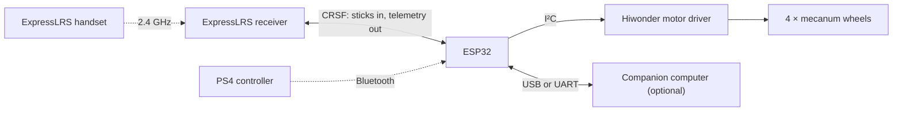

# ESP32 Mecanum Robot Controller

[](https://github.com/Lishen99/ELRS-ESP32-MecanumController/actions/workflows/ci.yml)
[](LICENSE)
[](https://platformio.org)


Firmware that turns an ESP32 into the drive controller of a four-wheel
mecanum robot. Drive the robot with an **ExpressLRS radio handset** or a
**PS4 controller**: the ESP32 mixes the sticks into individual wheel speeds,
sends them to a **Hiwonder I²C motor driver**, enforces arming and failsafes,
and reports the robot's state back to the handset. An optional companion
computer (Jetson, Raspberry Pi, PC) can follow everything over a serial link
and send its own telemetry to the handset.



## Features

- **Omnidirectional driving.** Forward, sideways, diagonally and turning on
  the spot, with the standard mecanum mix and smooth acceleration and braking.
- **Two controllers.** An ExpressLRS handset over CRSF, and a PS4 DualShock 4
  over Bluetooth. The handset is in charge while its radio link is up; the PS4
  controller drives otherwise.
- **Throttle-style speed control.** A scroll wheel on the handset sets the
  speed limit, and the sticks use as much of it as they are pushed.
- **Safe by design.** The arm switch is a kill switch, arming requires the
  switch to be cycled, a lost link or controller brings the robot to a stop,
  and the motors are stopped on every restart, crash, brownout and watchdog
  reset.
- **Telemetry on the handset.** Robot status and battery voltage, plus GPS,
  attitude or a status text supplied by the companion computer.
- **Companion-computer link.** Channels, link quality and drive state stream
  at 50 Hz over USB or a UART, with ready-made Python and C++ clients.
- **Configurable at run time.** Every channel, pin, speed and rule is a named
  setting, changed from a serial command line and stored in flash. Remapping
  a control never needs a rebuild.
- **Tested.** 135 unit tests and 44 end-to-end tests run on the desktop
  against a simulated receiver, on every push.

## Hardware

| Part | Used on the reference robot | Alternatives |
|---|---|---|
| Microcontroller | ESP32 DevKit V1 (ESP32-WROOM-32) | any classic ESP32 board; the PS4 controller needs Bluetooth Classic, which the ESP32-S2/S3/C3 lack |
| Motor driver | Hiwonder 4-channel encoder motor driver (I²C) | – |
| Motors | 4 × JGB37-520 12 V gear motors with encoders | TT or N20 motors (`motor_type`) |
| Wheels | 4 × mecanum wheels, rollers forming an X seen from above | – |
| Radio receiver | Happymodel EP1 (ExpressLRS 2.4 GHz) | any ExpressLRS receiver with CRSF output |
| Radio handset | RadioMaster Zorro (EdgeTX, internal ExpressLRS module) | any ExpressLRS handset |
| Gamepad | Sony DualShock 4 | optional |
| Companion computer | NVIDIA Jetson, Raspberry Pi, PC | optional |

Wiring, power and pin assignments are in [docs/hardware.md](docs/hardware.md).

## Getting started

**1. Build and flash.** Install [PlatformIO](https://platformio.org/install)
(the command-line tools or the VS Code extension), connect the ESP32 over USB
and run:

```bash
git clone https://github.com/Lishen99/ELRS-ESP32-MecanumController.git
cd ELRS-ESP32-MecanumController
pio run -t upload
```

The first build downloads the Bluepad32 edition of the ESP32 Arduino core
(about 200 MB), which provides the Bluetooth gamepad support.

**2. Open the command line.**

```bash
pio device monitor
```

Type `status`. It should report `motor board: answering`; if it does not,
check the I²C wiring and the motor driver's power.

**3. Set up the radio.** Flash and bind the receiver, then put the arm switch
on CH5 and the speed wheel on CH12: see [docs/radio-setup.md](docs/radio-setup.md).

**4. Drive.** Work through the
[first power-up checklist](docs/driving.md#first-power-up) with the wheels off
the ground before the robot goes on the floor.

## Controls

**ExpressLRS handset** (mode 2, AETR channel order):

| Control | Action |
|---|---|
| CH5 switch | arm; switching it off stops the wheels at once |
| Right stick up / down (CH2) | forward / back |
| Right stick left / right (CH1) | sideways |
| Left stick left / right (CH4) | turn on the spot |
| S1 scroll wheel (CH12) | speed: stopped at the bottom, 80 % of the maximum at the top |

**PS4 controller:**

| Control | Action |
|---|---|
| Left stick | forward / back and sideways |
| Right stick left / right | turn on the spot |
| Hold L2 / hold R2 | slow / fast |

Pair the PS4 controller by holding **Share** and **PS** until the light bar
flashes. The light bar is green while it drives, amber while it waits for its
sticks to be centred, and red while the handset is in charge.

The full behaviour, including the speed control, arming rules and failsafes,
is described in [docs/driving.md](docs/driving.md).

## Documentation

| Guide | Contents |
|---|---|
| [Hardware](docs/hardware.md) | parts, wiring, power, pin assignments, optional extras |
| [Radio setup](docs/radio-setup.md) | flashing and binding the ExpressLRS receiver, handset channel setup, telemetry |
| [Driving](docs/driving.md) | controls, speed, priority, arming, stopping and failsafes, first power-up |
| [Settings](docs/settings.md) | every command and setting of the serial command line |
| [Companion computer](docs/companion-computer.md) | following the robot from Python or C++, sending telemetry |
| [Protocol](docs/protocol.md) | binary and text wire formats, for writing a client in another language |
| [Troubleshooting](docs/troubleshooting.md) | symptoms, causes and fixes |
| [Development](docs/development.md) | architecture, code layout, tests, simulator |

## Project status

| | |
|---|---|
| Verified on the robot | ESP32 DevKit V1 with the Hiwonder driver and JGB37-520 motors; Happymodel EP1 on ExpressLRS 3.5.4 linked to a RadioMaster Zorro; arming, driving and the speed wheel; the command line and the Python client over USB |
| Implemented, verified in tests only | PS4 controller driving |
| Desktop tests | 135 unit tests, 44 end-to-end tests with a simulated receiver |

## Repository layout

```
src/esp32/         ESP32 hardware layer: motor driver, Bluetooth gamepad, UARTs, watchdog, LED
lib/bridge_core/   portable core: drive logic, CRSF, failsafe and arming, settings, command line
src/sim/           desktop simulator of the core, with TCP sockets in place of the UARTs
host/python/       Python client, command-line tools, example, end-to-end tests
host/cpp/          C++ / Arduino client library for a companion microcontroller
test/              unit tests
docs/              user and developer documentation
```

Details in [docs/development.md](docs/development.md).

## Contributing

Issues and pull requests are welcome. Please run the unit tests
(`pio test -e native`) and the end-to-end tests (see
[docs/development.md](docs/development.md#tests)) before submitting a change,
and update the documentation alongside any change in behaviour or settings.

## License

Released under the [MIT License](LICENSE).

## Acknowledgements

- [ExpressLRS](https://www.expresslrs.org/) for the radio link and the CRSF
  protocol.
- [Bluepad32](https://github.com/ricardoquesada/bluepad32) by Ricardo Quesada
  for Bluetooth gamepad support, and
  [pio-framework-bluepad32](https://github.com/maxgerhardt/pio-framework-bluepad32)
  for its PlatformIO packaging.
- [PlatformIO](https://platformio.org/) and the
  [Unity](https://github.com/ThrowTheSwitch/Unity) test framework.
