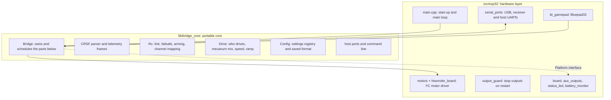

# Development

How the firmware is organised, how to build it for each target, and how it is
tested.

## Architecture

The code is split into two layers so that everything except direct hardware
access can be built and tested on a desktop computer.



- **`lib/bridge_core`** (namespace `eb`) holds the logic: CRSF decoding,
  channel mapping, failsafe and arming, the drive logic, telemetry
  scheduling, the settings registry, the companion-computer protocol and the
  command line. It never touches hardware. What it needs from the board, such
  as settings storage and pin validation, goes through the `eb::Platform`
  interface in `eb_platform.h`.
- **`src/esp32`** is the hardware layer for the ESP32. `main.cpp` only wires
  the modules together; each module has one job.
- **`src/sim`** runs the same core on a desktop computer, with TCP sockets in
  place of the UARTs.

### Main loop

`setup()` loads the saved settings and stops the motor driver before anything
else, in case a restart left it running. `loop()` then never blocks, apart
from one short I²C transfer every 10 ms:

1. feed the task watchdog;
2. read the receiver and both host ports into the core;
3. pass the latest gamepad report to the core;
4. `Bridge::tick()`: link and arming state, drive logic, telemetry;
5. send due motor commands to the driver;
6. update the aux pins;
7. send queued output to the host ports;
8. update the status LED and the battery reading.

### Safety mechanisms

- **Drive logic** (`eb_drive.cpp`): a disarmed handset stops the wheels at
  once; a lost controller ramps them down or stops them (`drive_fs`); a
  gamepad that takes over must first report centred sticks.
- **Output guard** (`output_guard.cpp`): a restart of the ESP32 resets the CPU
  but not the motor driver or the GPIO matrix. The guard hooks the panic
  handler, every software restart path (via the linker's `--wrap`, see
  `platformio.ini`), the brownout handler and the task watchdog. On any of
  them it releases the aux pins and sends the motor driver a stop by driving
  the I²C lines directly from IRAM, which works even when the I²C driver or
  the scheduler cannot be used.
- **Watchdog** (`board.cpp`): the loop task is watched with a one-second
  timeout.
- **Command line** (`eb_cli.cpp`): commands that would pause the controller,
  such as writing the flash, are refused while the robot is armed or moving.

## Building

The project uses [PlatformIO](https://platformio.org/). Its environments:

| Environment | Command | Builds |
|---|---|---|
| `esp32dev` (default) | `pio run -t upload` | the firmware, and flashes it |
| `native` | `pio test -e native` | the unit tests, and runs them |
| `sim` | `pio run -e sim` | the desktop simulator |

The ESP32 build uses the Bluepad32 edition of the Arduino-ESP32 core (based
on Arduino-ESP32 2.0.17 / ESP-IDF 4.4), pinned to a fixed version in
`platformio.ini`. PlatformIO downloads it on the first build, about 200 MB.
It replaces PlatformIO's shared `framework-arduinoespressif32` package, so
other ESP32 projects on the same computer download the standard core again
the next time they build.

The desktop builds need a C++11 compiler on the PATH: GCC or Clang on Linux
and macOS, MinGW-w64 GCC (for example from MSYS2) on Windows.

## Tests

### Unit tests

```bash
pio test -e native
```

Each folder under `test/` is one test program for one area of the core:

| Program | Covers |
|---|---|
| `test_crsf` | CRSF frame parsing, channel packing, telemetry frames |
| `test_rc` | link detection, failsafe, arming rules, channel mapping |
| `test_drive` | controller priority, mecanum mix, speed control, ramps, stopping |
| `test_settings` | the settings registry, validation and the saved format |
| `test_bridge` | the assembled core: receiver to motors, command line, telemetry |
| `test_host_ports` | the companion-computer ports: streaming, back-pressure, modes |
| `test_host_protocol` | the protocol encoder and decoder shared with the C++ client |
| `test_host_client` | the C++ client library |

Shared test helpers (a fake platform, a simulated handset, a bench that
captures the core's output) live in `test/support`. Run a single program with
`pio test -e native -f test_drive`.

### End-to-end tests

```bash
pio run -e sim
python host/python/test_with_simulator.py
```

These start the simulator, play the receiver with
`host/python/fake_receiver.py` (an independent CRSF implementation, so the
firmware's codec is cross-checked), and drive the Python client against it.
They need Python 3.6 or newer and `pyserial`.

### Continuous integration

GitHub Actions ([`.github/workflows/ci.yml`](../.github/workflows/ci.yml))
runs the unit tests, the end-to-end tests and the firmware build on every
push and pull request.

## Using the simulator

The simulator exposes the receiver port on TCP port 5760, the host UART on
5761 and the USB port on 5762. In three terminals:

```bash
.pio/build/sim/program
python host/python/fake_receiver.py sweep --arm
python host/python/elrs_bridge.py socket://localhost:5761 monitor
```

This is a convenient way to develop companion-computer code without any
hardware. Settings are saved to `sim_settings.txt` instead of flash.

## Conventions

- One file per job; `main.cpp` only connects the modules.
- Comments explain why, not what.
- Every setting is declared once, in the registry in `eb_config.cpp`, which
  provides its name, range, help text, default and saved form. A new setting
  also needs a row in [settings.md](settings.md).
- Behaviour changes come with tests, and the documentation is updated in the
  same change.
