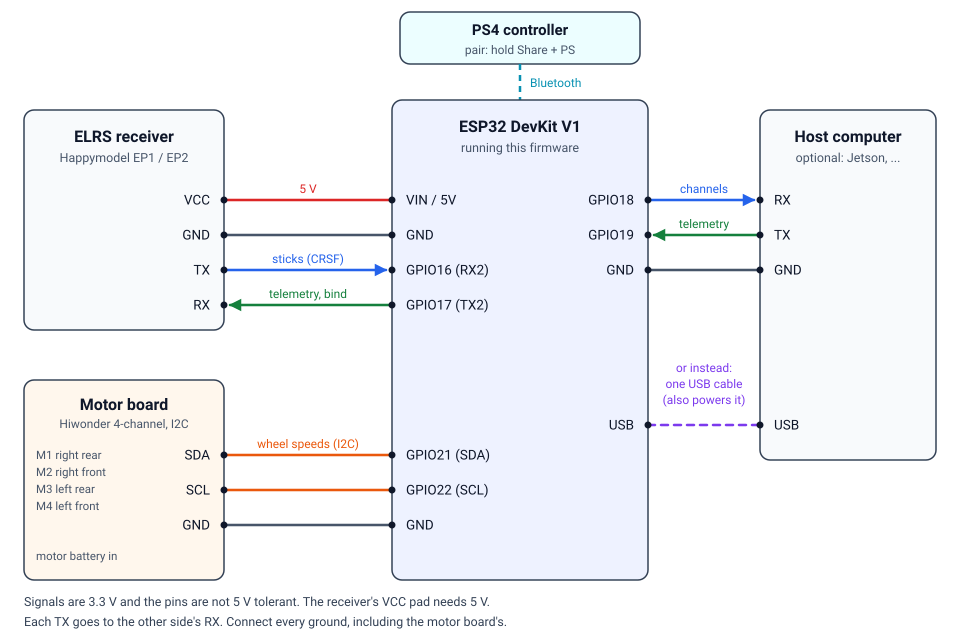

# Hardware

This guide covers the parts, the wiring, power and the pin assignments. All
pins are settings, so a different layout only needs a few `set` commands (see
[settings.md](settings.md)), never a rebuild.

## Parts

| Part | Reference robot | Notes |
|---|---|---|
| Microcontroller | ESP32 DevKit V1 (ESP32-WROOM-32) | Any classic ESP32 board works. The PS4 controller uses Bluetooth Classic, which the ESP32-S2, S3 and C3 do not have. |
| Motor driver | Hiwonder 4-channel encoder motor driver | I²C, closed-loop speed control per channel |
| Motors | 4 × JGB37-520, 12 V, 110 rpm, with encoders | `motor_type` also supports TT, N20 and motors without encoders |
| Wheels | 4 × mecanum wheels | Standard layout: seen from above, the rollers form an X |
| Receiver | Happymodel EP1 or EP2, ExpressLRS 2.4 GHz | Any ExpressLRS receiver with CRSF output. The EP1 takes an external antenna, the EP2 has one on the board. |
| Handset | RadioMaster Zorro, EdgeTX with an internal ExpressLRS module | Any ExpressLRS handset |
| Gamepad (optional) | Sony DualShock 4 | Other gamepads supported by Bluepad32 should work the same way, but are untested |
| Companion computer (optional) | NVIDIA Jetson, Raspberry Pi or a PC | See [companion-computer.md](companion-computer.md) |

## Wiring



Signals are 3.3 V and the ESP32's pins are **not 5 V tolerant**. Every TX goes
to the other side's RX, and every ground connects to every other ground.

| Link | ESP32 pins | Speed | Setting |
|---|---|---|---|
| Receiver (CRSF) | GPIO16 RX, GPIO17 TX | 420000 baud, the ExpressLRS default | `crsf_baud` |
| USB serial: command line and Python tools | USB | 115200 baud | `usb_baud` |
| Companion-computer UART | GPIO19 RX, GPIO18 TX | 115200 baud | `host_baud` |
| Motor driver (I²C) | GPIO21 SDA, GPIO22 SCL | 100 kHz | – |

Firmware uploads use 921600 baud (`upload_speed` in `platformio.ini`).

### Receiver

| Receiver pad | ESP32 DevKit V1 | Notes |
|---|---|---|
| VCC | VIN (5 V) | The receiver needs 5 V (4.5 V minimum), not 3.3 V |
| GND | GND | |
| TX | GPIO16 (RX2) | Sticks from the receiver |
| RX | GPIO17 (TX2) | Telemetry and the bind command to the receiver |

The receiver's serial output must be CRSF at 420000 baud, the ExpressLRS
default.

If TX and RX turn out to be the wrong way round there is no need to resolder:
swap them in software and restart.

```
set crsf_rx_pin 17
set crsf_tx_pin 16
save
reboot
```

### Motor driver

| Hiwonder driver | ESP32 DevKit V1 |
|---|---|
| SDA | GPIO21 |
| SCL | GPIO22 |
| GND | GND |

The driver answers at I²C address `0x34`; the bus runs at 100 kHz. The
motors and their battery connect to the driver as its documentation
describes.

The default assignment of driver channels to wheels:

| Channel | Wheel | Direction |
|---|---|---|
| M1 | back right | normal |
| M2 | front right | reversed |
| M3 | back left | reversed |
| M4 | front left | normal |

"Reversed" means a positive speed command turns that wheel backwards, which
is how motors mounted mirror-image are compensated. Both the wheel and the
direction of every channel are settings (`motorN.wheel`, `motorN.rev`), so a
robot wired differently is fixed from the command line. To check the
assignment, put the robot on a stand and drive forward slowly:

- every wheel should turn forward; a wheel turning backwards needs its
  `motorN.rev` flipped;
- driving sideways should move the robot sideways; if it turns instead, two
  channels drive each other's wheels and their `motorN.wheel` values need
  swapping.

### Companion computer (optional)

Either connection carries the same data and the same command line.

**USB.** Plug the ESP32's USB port into the computer. It appears as a serial
port (`/dev/ttyUSB0` on Linux, `COMx` on Windows) and also powers the ESP32.
Opening the port can reset some boards, which suits development more than a
finished robot.

**UART.** Three wires to a hardware UART, for a permanent installation:

| ESP32 | Companion computer | Jetson 40-pin header |
|---|---|---|
| GPIO18 (host TX) | RX | pin 10 |
| GPIO19 (host RX) | TX; only needed to send telemetry or commands | pin 8 |
| GND | GND | pin 6 |

On a Jetson this UART is usually `/dev/ttyTHS1`. A 5 V board needs a level
shifter on the line into the ESP32.

## Power

- **Motor driver:** from the drive battery, as specified for the driver and
  motors.
- **ESP32:** from USB, or from a regulated 5 V supply on the VIN pin.
- **Receiver:** 5 V from the DevKit's VIN pin. It draws about 50–70 mA, with
  short peaks of a few hundred.
- **Grounds:** ESP32, receiver, motor driver and companion computer must share
  a common ground.

> [!IMPORTANT]
> **Switch the ESP32 and the motor driver on and off together.** The driver
> keeps running the motors at the last speed it received. The ESP32 sends a
> stop whenever it restarts or crashes, but it cannot do so without power.
> For the same reason, **disarm before flashing**: while the ESP32 is being
> programmed, the driver carries on at its last speed.

If `status` reports `last reset: brownout`, the 5 V supply sags under load:
use shorter or thicker wires, or add a capacitor across 5 V and GND.

## Status LED

The DevKit's blue LED on GPIO2 shows the drive state:

| LED | Meaning |
|---|---|
| Slow blink | No controller: no radio link and no PS4 controller |
| Steady | A controller is connected, the wheels are stopped (disarmed, or the PS4 controller is waiting for its sticks to be centred) |
| Fast blink | The wheels follow the sticks |

## Optional extras

| Function | Pin | Setup |
|---|---|---|
| Battery voltage on the handset | GPIO34 or 35 | Divider from the battery: 100 kΩ to battery +, 10 kΩ to GND, the junction to the pin. Then `set vbat_pin 34`, `save`, `reboot`, and calibrate `vbat_scale` against a multimeter. |
| Motor-enable relay, energised only while the wheels may move | e.g. GPIO25 | `set aux1.pin 25`, `set aux1.mode armed`, `save`, `reboot`. Add a pull-down resistor. |
| Servo or ESC following a handset channel | e.g. GPIO26, 27 or 33 | `set aux2.pin 26`, `set aux2.src 7`, `save`, `reboot` |

The aux pins are described in detail in [settings.md](settings.md#aux-pins-aux1--aux4).

## Pin usage

| GPIO | Default use |
|---|---|
| 1, 3 | USB serial (fixed: the command line is always reachable) |
| 2 | Status LED |
| 16 | CRSF from the receiver (`crsf_rx_pin`) |
| 17 | CRSF to the receiver (`crsf_tx_pin`) |
| 18 | Companion-computer UART TX (`host_tx_pin`) |
| 19 | Companion-computer UART RX (`host_rx_pin`) |
| 21 | I²C SDA to the motor driver (`motor_sda`) |
| 22 | I²C SCL to the motor driver (`motor_scl`) |

Free with the default settings: GPIO4, 13, 23, 25, 26, 27, 32 and 33, plus
GPIO34, 35, 36 and 39 as inputs only. Avoid GPIO0, 5, 12 and 15 for external
circuits (they select the boot mode) and GPIO6–11 (connected to the flash).
The firmware refuses pins that cannot do a job, such as an input-only pin as
an output, and warns when two functions share a pin.

## Mounting

Keep the receiver's antenna away from the motors, their wiring, the battery
leads and metal. On a metal chassis, use the EP1 and route its antenna to the
outside.
